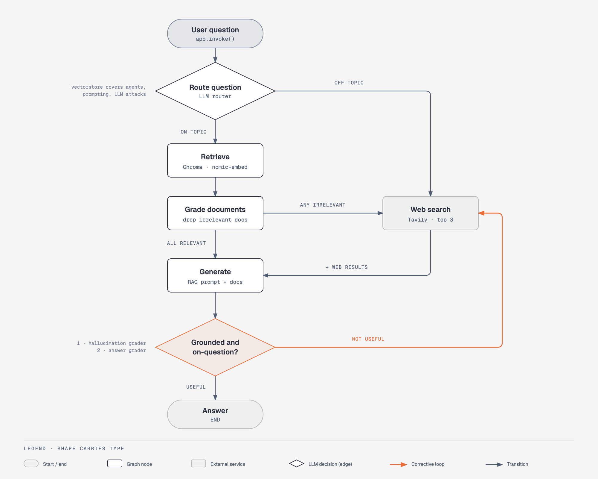
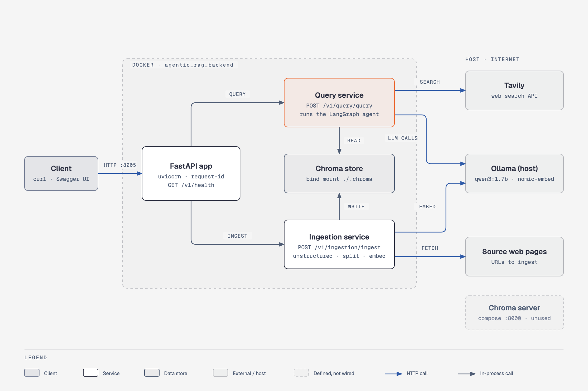

# Agentic RAG

This is a pet project. The agent was first built as a way to get familiar with agentic RAG. The backend came later, to dockerize the app and run it on AWS Fargate. Because the project grew in that order, the layout is not production standard.

## How it works

The project implements agentic RAG and self-RAG with LangGraph.



A router first decides where the context should come from. Questions about the indexed topics (agents, prompt engineering, adversarial attacks on LLMs) go to the vector store. Everything else goes to web search.

In the vector store flow, each retrieved document is graded for relevance and irrelevant ones are dropped. If any were dropped, a web search is added to fill the gap.

The LLM then generates an answer from the remaining context. Before returning it, the agent checks two things: that the answer is grounded in the context (no hallucination), and that it actually answers the question. If both checks pass, the answer is returned. Otherwise the agent searches the web and tries again.

All models run locally through Ollama: qwen3:1.7b for routing, grading and generation, and nomic-embed-text for embeddings.

## Backend



The agent started as a script, which can't be deployed to Fargate. Fargate runs long-lived containers that serve traffic, so the agent needed an HTTP entrypoint. A FastAPI app in backend/main.py provides it, and the whole thing is packaged with Docker.

The API has three endpoints. `POST /v1/query/query` runs the agent on a question. `POST /v1/ingestion/ingest` loads web pages into the vector store. `GET /v1/health` is used by the container health check, and Fargate can use it to replace unhealthy tasks.

## Tracing

Tracing is done with LangSmith. The router, the graders and the generation step are each built as a LangChain runnable chain (prompt piped into the model), following LangChain best practices. Because of that, every step shows up in LangSmith as its own run, nested under the graph run. You can see what each LLM call received and returned, and how long it took.

## Setup

The project is developed against Ollama, so all models run locally. Development used qwen3:1.7b as the LLM and nomic-embed-text for embeddings. Install [Ollama](https://ollama.com) and pull both models:

```bash
ollama pull qwen3:1.7b
ollama pull nomic-embed-text
```

Clone the repo:

```bash
git clone <repo-url> agentic_rag
cd agentic_rag
```

Create a `.env` file in the project root:

```bash
# Required: web search
TAVILY_API_KEY=your-tavily-key

# Optional: LangSmith tracing
LANGSMITH_TRACING=true
LANGSMITH_API_KEY=your-langsmith-key
LANGSMITH_PROJECT=agentic-rag
```

Start the backend with Docker Compose. It reads `.env` and connects to the Ollama running on your machine:

```bash
docker compose up -d --build agentic_rag_backend
```

The API runs on http://localhost:8005, with interactive docs at http://localhost:8005/docs. Stop it with `docker compose stop agentic_rag_backend`.

The vector store starts empty. Ingest the default source pages, then ask a question:

```bash
curl -X POST localhost:8005/v1/ingestion/ingest -H "Content-Type: application/json" -d '{}'

curl -X POST localhost:8005/v1/query/query -H "Content-Type: application/json" \
  -d '{"query": "What is agent memory?"}'
```

To run without Docker, use Python 3.13:

```bash
python -m venv env && source env/bin/activate
pip install -r requirements.txt
uvicorn backend.main:app --port 8005 --reload
```
